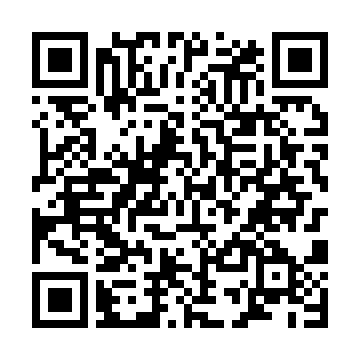

# FBI 日本語版

[FBI 2.6.1](https://github.com/Steveice10/FBI)の日本語版です。

- 日本語化: **yu_**
- 原作者: **Steveice10**

[ダウンロード](https://github.com/Yu08083/FBI-JP/releases/latest)

FBIの「ネットワークインストール」→「QRコードを読み取る」で読み込んでください。

`FBI-JP.cia`をSDカードに置き、FBIからインストールしてください。既存のFBIを置き換えます。

TXTを選び、「テキストを編集」を開きます。行番号付き一覧から行を選んで編集できます。UTF-8、32KBまで対応しています。

- A: 選択行を編集、Y: 検索、START: 保存
- X: 行の追加・削除、行番号への移動、全文編集
- SELECT: 直前の編集を戻す、L/R: 長い行の本文を送る

アプリ内の「更新」から最新版をインストールできます。更新後は一度終了して開き直してください。

## クレジット

- FBI: Steveice10
- Banner: OctopusRift、Apache Thunder、PabloMK7
- Logo: PabloMK7
- SPI protocol information: TuxSH ([TWLSaveTool](https://github.com/TuxSH/TWLSaveTool))
- stb_image: Sean Barrett
- quirc: Daniel Beer

原版の[MITライセンス](LICENSE.txt)を継承しています。同梱ライブラリーのライセンスは[stb_image](LICENSES/stb_image.txt)と[quirc](source/libs/quirc/LICENSE)を参照してください。
